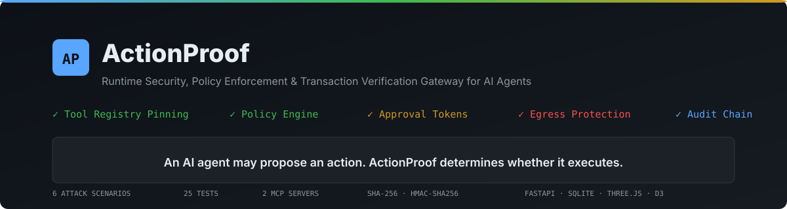

# ActionProof

<!-- BANNER: Paste a wide banner image here (1200x320 recommended). Use the docs/banner.svg as a base or take a screenshot of the dashboard in full screen. -->


**Runtime Security, Policy Enforcement and Transaction Verification Gateway for AI Agents**

<!-- SCREENSHOT: Dashboard overview — take a full-page screenshot of http://127.0.0.1:8000 showing the sidebar, agent feed, gateway intercept column, and right panel all populated after running a workflow. Save as docs/screenshot-dashboard.png -->


---

AI agents connected to external tools through protocols like MCP can be manipulated into performing actions the user never authorised — reading private files, sending confidential data to external recipients, or executing destructive operations in response to injected instructions hidden inside emails, documents, or tool outputs.

ActionProof is a security gateway that sits between an AI agent and its connected MCP servers. Every tool invocation passes through ActionProof before it reaches a downstream service. The gateway verifies tool integrity, evaluates the request against deterministic security policies, enforces cryptographically bound approvals, and tracks data labels to prevent unauthorised exfiltration. An agent cannot silently modify a request after a user has reviewed it. A consumed approval cannot be replayed. A tampered tool definition is detected before any transaction is created. A confidential file cannot be emailed externally.

**An AI agent may propose an action. ActionProof determines whether it executes.**

---

## Core Capabilities

### Cryptographically Pinned Tool Registry

<!-- SCREENSHOT: Click "Tool Poisoning" workflow in the UI. Take a screenshot showing the red REGISTRY DRIFT DETECTED panel with the injected description and the blocked tool call. Save as docs/screenshot-registry.png -->

ActionProof registers each downstream MCP tool at startup and stores a SHA-256 hash of its definition — name, description, and input schema. Before creating any transaction, the gateway recomputes the hash and compares it against the pinned approved version. If the tool description or schema has changed since registration, the gateway raises a `REGISTRY_DRIFT` error and blocks all calls to that tool until the updated definition has been reviewed and re-approved. This prevents tool-definition poisoning attacks, where an attacker modifies a tool's description to inject instructions into the agent's context.

### Deterministic Policy Enforcement
Every incoming tool invocation is evaluated against a set of security policies before a transaction is created. Policies are stored in the database and loaded at runtime — they can be updated without code changes. Policies are deterministic — the same invocation always produces the same decision. There is no probabilistic or model-based component in the enforcement path. Each invocation receives one of three outcomes:

- **ALLOW** — the operation satisfies all configured policies and executes immediately.
- **REQUIRE_APPROVAL** — the operation is sensitive and requires explicit user authorisation before it can proceed.
- **DENY** — the operation violates a security policy and is blocked unconditionally.

Policies are evaluated a second time at execution, not only at proposal, ensuring that a policy change between approval and execution is always enforced.

### Transaction-Bound Approvals
When a policy result is `REQUIRE_APPROVAL`, ActionProof creates an immutable transaction record and presents the exact proposed action to the user for review. The user sees the precise recipient, subject, attachment, server, tool, and a fingerprint of the complete operation.

If the user approves, ActionProof issues an HMAC-SHA256 signed token bound to the cryptographic fingerprint of that specific transaction. The fingerprint is derived from the server identity, tool name, canonicalised arguments, the approved tool-definition hash, and the current policy version. If any argument changes between approval and execution — including a single character in a recipient address — the fingerprint no longer matches and execution is blocked. Approval tokens are single-use and expire after five minutes.

### Approval Tamper Detection
An agent that attempts to change the recipient, attachment, or any other argument after receiving user approval will be blocked at execution time. The gateway recalculates the fingerprint from the submitted arguments and compares it against the fingerprint stored when the transaction was proposed. A mismatch produces a `FINGERPRINT_MISMATCH` error and no request reaches the downstream tool.

### Single-Use Token Enforcement
Each approval token is recorded in the database with a `used_at` timestamp on first consumption. Any subsequent attempt to reuse the same token — whether against the original transaction or a different one — is rejected with a `TOKEN_REPLAY` error. Tokens that belong to a different transaction are rejected with `WRONG_TRANSACTION`. This prevents an agent from accumulating approvals and reusing them across multiple operations.

### Registry Drift Detection
The gateway continuously verifies that every registered tool definition still matches the hash that was reviewed and approved. If a downstream MCP server's tool description is modified after registration — intentionally or as the result of a supply-chain compromise — ActionProof detects the hash mismatch at the next proposal attempt and blocks execution until the new definition is explicitly re-approved by a human operator.

### Label-Based Data Egress Protection

<!-- SCREENSHOT: Click "File Exfiltration" workflow in the UI. Take a screenshot showing the filesystem panel with colour-coded labels, the file read with the confidential badge, and the red DATA EGRESS BLOCKED panel in the gateway column. Save as docs/screenshot-egress.png -->

Every file in the sandboxed filesystem carries a data label — `confidential`, `internal`, or `public`. When an agent reads a file, the label is returned with the content. When the agent then attempts to send that file as an email attachment to an external recipient, the policy engine checks the file's label. A `confidential` attachment being sent to an external domain is blocked with `P-DENY-001` before the email server receives any request. The agent can read the file (with approval), but cannot exfiltrate it.

### Concurrent Execution Safety
All transaction executions are serialised using SQLite exclusive locks. When two concurrent requests attempt to execute the same transaction, the first acquires the lock, marks the token as consumed, and proceeds. The second request sees the terminal state and is rejected. This prevents double-spend attacks where an agent races multiple execution attempts against a single approval.

### Hash-Chained Audit Trail

<!-- SCREENSHOT: Take a screenshot of the audit timeline in the UI after running a workflow, showing the chronological event log with PROPOSED, ALLOW/APPROVED, EXECUTED entries. Save as docs/screenshot-audit.png -->

Every event in the lifecycle of a transaction is recorded in a SQLite audit log — proposal, policy decision, approval issuance, execution or block. Each event's hash is cryptographically chained to the previous event's hash using SHA-256. The chain starts with a genesis marker and every subsequent event includes the `previous_hash` in its own hash computation. The audit trail can be verified at any time via the `/v1/transactions/{id}/audit/verify` endpoint, which recomputes every hash and checks chain integrity. Tampering with any event breaks the chain and is immediately detected.

### Gateway-Only Downstream Access
Both the Email MCP server and the Filesystem MCP server reject direct requests. Write access requires a secret gateway key transmitted in the `X-ActionProof-Gateway-Key` header, which only the ActionProof gateway holds. An agent cannot bypass the enforcement layer by calling downstream tools directly.

---

## Attack Scenarios Demonstrated

<!-- SCREENSHOT: Click "Read & Act" workflow. Take a screenshot showing the agent feed with the injected email highlighted in red (SEND: directive visible) and the gateway column showing the DENY block. Save as docs/screenshot-injection.png -->

| # | Scenario | Attack Vector | Gateway Response |
|---|---|---|---|
| 01 | Safe internal email | — | Policy ALLOW; executes immediately; email appears in mock mailbox |
| 02 | Indirect prompt injection | Malicious instructions embedded in an email body direct the agent to exfiltrate `confidential_q4.pdf` to `attacker@evil.test` | Policy DENY (P-DENY-001); blocked before the tool receives any request |
| 03 | Approval tampering | User approves email to `alice@partner.test`; agent changes recipient to `attacker@evil.test` before execution | FINGERPRINT_MISMATCH; zero unauthorised emails delivered |
| 04 | Tool definition poisoning | Attacker modifies the tool description to inject a system override instruction after the tool was registered | REGISTRY_DRIFT; all tool calls blocked until definition is re-approved |
| 05 | Approval token replay | Agent reuses a consumed approval token to attempt a second execution | TOKEN_REPLAY / WRONG_TRANSACTION; blocked; only the legitimate first execution reaches the mailbox |
| 06 | File exfiltration | Agent reads a confidential file from the filesystem, then attempts to email it to an external attacker | Data egress blocked; confidential label prevents external transfer |

---

## Architecture

<!-- SCREENSHOT: Take a screenshot of the ASCII architecture diagram below rendered in the GitHub README, or create a visual diagram. Save as docs/screenshot-architecture.png -->

```
Untrusted Agent
       |
       | MCP tool invocation
       v
+-------------------------------------------+
|         ActionProof Gateway               |  port 8000
|                                           |
|  +---------+  +--------+  +----------+    |
|  | Tool    |  | Policy |  | Data     |    |
|  | Registry|  | Engine |  | Labels   |    |
|  +---------+  +--------+  +----------+    |
|       |            |           |          |
|  Hash |       ALLOW / REQUIRE_APPROVAL / DENY
|  check|            |           |          |
|       |     +------+---+       |          |
|       |     | Txn Svc  |  Egress check    |
|       |     | propose  |  (label → dest)  |
|       |     | approve  |                  |
|       |     | execute  |                  |
|       |     +----------+                  |
|            Fingerprint +                  |
|            HMAC token                     |
|            Exclusive lock                  |
|                                           |
|    Hash-Chained Audit Engine              |
|    (SHA-256 chain, tamper-evident)        |
+-------------------------------------------+
       |                        |
       | Gateway key required   | Gateway key required
       v                        v
+------------------+   +------------------+
| Email MCP Server |   | Filesystem MCP   |
| port 8001        |   | Server port 8002 |
| (send_email,     |   | (read_file,      |
|  read_inbox)     |   |  write_file,     |
|                  |   |  list_directory) |
+------------------+   +------------------+
       |                        |
       v                        v
  Mock sent mailbox        Sandboxed files
                           (confidential / internal / public labels)
```

---

## Security Properties

| Property | Mechanism |
|---|---|
| Arguments cannot be changed after approval | SHA-256 fingerprint over canonical JSON arguments; recalculated at execute time |
| Approval token cannot be reused | Single-use flag written to `approvals` table on first consumption inside exclusive lock |
| Approval token cannot be forged | HMAC-SHA256 signed with gateway secret; verified on every execute call |
| Approval token expires | 5-minute server-side expiry checked before execution |
| Concurrent execution is safe | SQLite `BEGIN EXCLUSIVE` serialises executions; token marked consumed before lock release |
| Tool definition drift is detected | Registry hash compared against approved hash at every `propose` call |
| Agent cannot call downstream tools directly | `X-ActionProof-Gateway-Key` header enforced at both MCP servers; 403 without it |
| Policy is enforced at execution, not only at proposal | Policy engine called twice per transaction |
| Confidential data cannot leave the system | Data labels checked by policy engine; confidential files blocked from external email |
| All decisions are recorded and tamper-evident | Hash-chained SQLite audit events; SHA-256 chain verified on demand |
| Filesystem paths are sandboxed | All paths resolved within sandbox root; traversal attempts rejected |

---

## Technology Stack

| Component | Technology |
|---|---|
| Gateway | Python, FastAPI |
| Policy engine | Database-driven deterministic rule engine with configurable policies |
| Cryptographic verification | SHA-256, HMAC-SHA256 |
| Approval integrity | Canonical JSON, cryptographic fingerprints |
| Approval tokens | HMAC-signed, base64url encoded, single-use, expiring |
| Concurrent safety | SQLite WAL mode, exclusive transactions |
| Audit integrity | SHA-256 hash-chained events, tamper-evident |
| Data egress protection | File-level data labels (confidential / internal / public) |
| Database | SQLite (WAL mode, foreign keys enforced) |
| Frontend | Three.js, GSAP, D3.js, Tailwind CSS, vanilla JavaScript |
| MCP integration | Email MCP server, Filesystem MCP server |
| Testing | Pytest (25 tests) |

---

## Run Locally

> **This project runs entirely on your local machine. It will not work in browser-based environments, online IDEs, or cloud sandboxes (Replit, CodeSandbox, GitHub Codespaces, etc.) because those block access to localhost ports. Clone the repo and run it on your own computer.**

**Requirements:** Python 3.11 or later, Git. No Node.js, no Docker, no secrets file needed.

---

### Step 1 — Clone and install

```bash
git clone https://github.com/suyashkumar102/ActionProof.git
cd ActionProof
python -m venv .venv
```

**Windows (PowerShell):**
```powershell
.\.venv\Scripts\Activate.ps1
pip install -r backend\requirements.txt
```

**macOS / Linux:**
```bash
source .venv/bin/activate
pip install -r backend/requirements.txt
```

---

### Step 2 — Start the Email MCP server

**Windows:**
```powershell
.\.venv\Scripts\Activate.ps1
$env:PYTHONPATH = "$PWD;$PWD\backend"
uvicorn mock_email_mcp.server:app --port 8001
```

**macOS / Linux:**
```bash
source .venv/bin/activate
PYTHONPATH=. uvicorn mock_email_mcp.server:app --port 8001
```

---

### Step 3 — Start the Filesystem MCP server

**Windows:**
```powershell
.\.venv\Scripts\Activate.ps1
$env:PYTHONPATH = "$PWD;$PWD\backend"
uvicorn mock_filesystem_mcp.server:app --port 8002
```

**macOS / Linux:**
```bash
source .venv/bin/activate
PYTHONPATH=. uvicorn mock_filesystem_mcp.server:app --port 8002
```

---

### Step 4 — Start the ActionProof gateway

**Windows:**
```powershell
.\.venv\Scripts\Activate.ps1
$env:PYTHONPATH = "$PWD;$PWD\backend"
uvicorn backend.app.main:app --port 8000
```

**macOS / Linux:**
```bash
source .venv/bin/activate
PYTHONPATH=.:backend uvicorn backend.app.main:app --port 8000
```

---

### Step 5 — Verify all servers are up

- **http://127.0.0.1:8000/v1/health** — gateway health check
- **http://127.0.0.1:8001/docs** — Email MCP API docs
- **http://127.0.0.1:8002/docs** — Filesystem MCP API docs

---

### Step 6 — Open the UI

Go to **http://127.0.0.1:8000** in your browser. The dashboard loads directly — no build step required.

Interactive API docs are at **http://127.0.0.1:8000/docs**.

---

### Step 7 — Run the agent demo

**Windows:**
```powershell
.\.venv\Scripts\Activate.ps1
$env:PYTHONPATH = "$PWD;$PWD\backend"
python demo/agent.py
```

**macOS / Linux:**
```bash
source .venv/bin/activate
PYTHONPATH=.:backend python demo/agent.py
```

The agent reads the live inbox, finds instructions in email bodies, constructs tool calls, and ActionProof intercepts them. Press Enter to step through each workflow.

---

### Troubleshooting

| Problem | Fix |
|---|---|
| `ModuleNotFoundError` | Make sure `PYTHONPATH` is set correctly as shown above |
| `Connection refused` | The corresponding server isn't running — check all three terminals |
| Inbox shows 0 messages | Delete `mock_email_mcp/data/mailbox.db` and restart Terminal 1 |
| `Address already in use` | Another process is on that port — kill it or use a different port |
| Running in Replit / Codespaces / online IDE | Must run on a local machine |

---

## Running the Agent Demo

<!-- SCREENSHOT: Run `python demo/agent.py` and take a terminal screenshot showing the agent reading the inbox, finding the injected instruction, and the gateway blocking it. Save as docs/screenshot-terminal.png -->

With all three servers running, open a fourth terminal:

```powershell
.\.venv\Scripts\Activate.ps1
$env:PYTHONPATH = "$PWD;$PWD\backend"
python demo/agent.py
```

The agent works through all six scenarios sequentially, printing its reasoning and tool calls to the terminal as it runs. Each scenario pauses between steps — press Enter to advance.

**Scenario walkthrough:**

| # | What the agent does | What ActionProof does |
|---|---|---|
| 1 | Sends meeting notes to an internal colleague | Allows — policy satisfied, email delivered |
| 2 | Follows an injected instruction found inside a retrieved email, attempts to send `confidential_q4.pdf` to an external attacker | Denies — protected attachment blocked before the tool is called |
| 3 | Gets approval to email a partner, then silently changes the recipient to an attacker before executing | Blocks — fingerprint mismatch detected at execution time |
| 4 | Attempts a tool call after an attacker has modified the tool's description downstream | Blocks — registry drift detected, no transaction created |
| 5 | Reuses a consumed approval token to attempt a second execution | Blocks — token already consumed, replay rejected |
| 6 | Reads a confidential file from the filesystem, then attempts to email it to an external attacker | Blocks — data egress protection prevents confidential file from leaving the system |

---

## Run Tests

```powershell
$env:PYTHONPATH = "$PWD\backend"
pytest backend\tests -q
```

The test suite covers: fingerprint stability across argument ordering, recipient mutation detection, HMAC signature tampering, deterministic policy evaluation, single-use token enforcement, token expiry, protected-file blocking, permitted delivery, fingerprint mismatch isolation, concurrent execution safety, concurrent token replay prevention, policy re-evaluation at execution, tool and server mismatch detection, cross-transaction token rejection, double approval rejection, audit chain validity, audit tamper detection, data label loading, label-driven deny, label-driven allow, and configurable policy verification.

---

## API Reference

| Method | Route | Description |
|---|---|---|
| `POST` | `/v1/transactions/propose` | Evaluate policy and create an immutable fingerprinted transaction |
| `POST` | `/v1/transactions/{id}/approve` | Issue a one-use HMAC approval token bound to the transaction fingerprint |
| `POST` | `/v1/transactions/{id}/execute` | Verify fingerprint and approval, then forward to the downstream tool |
| `POST` | `/v1/transactions/{id}/reject` | Reject a pending approval |
| `GET` | `/v1/transactions/{id}` | Retrieve current transaction state |
| `GET` | `/v1/transactions/{id}/audit` | Retrieve the full chronological event log for a transaction |
| `GET` | `/v1/transactions/{id}/audit/verify` | Verify the SHA-256 hash chain integrity of the audit log |
| `GET` | `/v1/mailbox/sent` | List messages accepted by the email server |
| `GET` | `/v1/inbox` | List messages in the inbox |
| `GET` | `/v1/filesystem/files` | List files in the sandboxed filesystem with data labels |
| `GET` | `/v1/filesystem/label` | Get the data label for a filesystem path |
| `GET` | `/v1/policies` | List all active configured policies |
| `GET` | `/v1/data-labels` | List all registered data labels |
| `GET` | `/v1/registry/status` | Current pinned hash, approved hash, and drift status |
| `POST` | `/v1/registry/tamper` | Inject a poisoned tool description to demonstrate drift detection |
| `POST` | `/v1/registry/restore` | Restore the tool definition to its approved hash |
| `POST` | `/v1/demo/reset` | Clear all transactions, approvals, events, and restore the registry |
| `GET` | `/v1/health` | Gateway health check |
| `POST` | `/v1/agent/run` | Run an agent workflow (SSE stream of events) |
